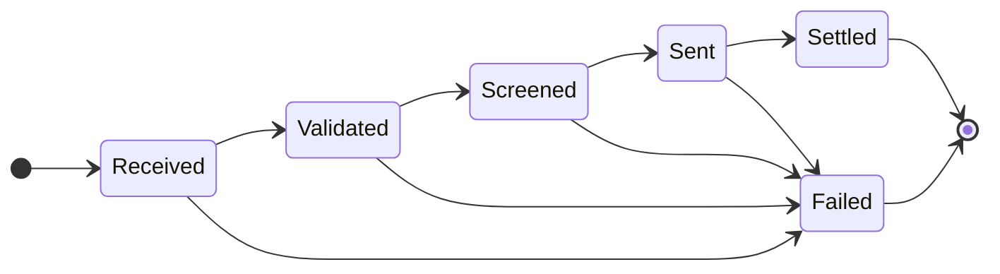

# Payment stages (the state machine)

Every payment follows the same path. Each arrow is a move the engine accepts; anything else
is blocked (see `can_move` in `engine/src/stage.cpp` and the test that checks all 36 pairs in
`engine/tests/test_stage.cpp`).

| Stage | Meaning | Time limit before "stuck" |
| --- | --- | --- |
| Received | the instruction arrives | 4 s |
| Validated | the details are correct | 4 s |
| Screened | compliance checks pass | 5 s |
| Sent | the payment leaves for the receiving bank | 6 s |
| Settled | the money has arrived (final) | none |
| Failed | the payment stopped for good (final) | none |

Time limits live in `config/engine.ini`. Simulated payments normally spend 0.1 to 1.2 s in a
stage, and about 2% are "normal slow" at 2 to 3.5 s, so the limits leave a safe margin.

## What the engine does with each event

| Situation | What happens | Alert |
| --- | --- | --- |
| The next stage on the path | applied | none (or `failed` / `amount_mismatch`) |
| An event ID already seen | ignored, counted once | `duplicate` notice |
| A stage further ahead than the next one | held for up to 1.5 s, waiting for the missing event | `out_of_order` notice if the gap fills |
| ...and the missing event never comes | the held event is applied anyway, payment marked invalid | `invalid_journey` |
| A stage the payment has already passed | ignored | none |
| No event at all for longer than the stage's limit | | `stuck` (cleared if the payment moves again) |
